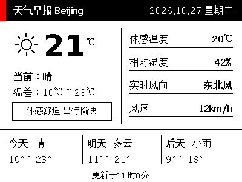

# EPD-ESP32gateway - 墨水屏无线中继网关与管理系统

[English](./README_EN.md) | 简体中文

一套基于 **ESP32 智能网关** 与 **nRF52811 电子价签 (EPD-nRF5 固件)** 的智能低功耗墨水屏物联网展示系统。支持 3 卡槽照片相册轮播、24 小时自定义分时段排程，以及通过手机快捷指令（iPhone Shortcuts）、Webhook 实现秒级插播即时桌面备忘。

> **说明**：当前工程包含完整的开源中继服务端代码（Python / FastAPI），以及适用于 **LilyGO T-Display-S3** 开发板的预编译固件二进制文件。后续版本将进一步移植适配至更低成本的标准 ESP32 / ESP32-C3 硬件方案。

---

## 核心特性

- **📸 电子相册轮播**：支持 3 卡槽独立照片管理，可自主配置 10~1440 分钟轮播间隔，内置 Floyd-Steinberg 与 Atkinson 艺术级三色（黑/白/红）抖动算法。
- **📅 在线日程看板 (iCal / Webcal)**：订阅 Apple Calendar / Google Calendar / 飞书日历，在 400×300 墨水屏上实时展现今日日程与时间刻度。
- **⛅ 实时气象与预报**：集成免 API Key 的 `wttr.in` 气象服务，自动根据 IP 定位或自定义城市呈现多天天气走势与温湿度指标。
- **⏰ 24 小时分时段自定义排程**：自由规划全天展示规则（如：上午时钟日历、下午待办事项/便签、晚间艺术相册、深夜极简免打扰休眠），支持跨午夜时间段自动识别。
- **🚀 手机即时备忘插播 (Priority Override)**：支持 iPhone 快捷指令或任意 HTTP POST/GET 推送桌面通知。支持自定义保留时长（如 30 分钟），到期后屏幕自动平滑回退常规时段排程。
- **⚡ BLE 5.0 固件协议自动适配**：内置版本特征嗅探算法，智能向下兼容适配绝大多数现存电子价签（如盒马/汉朔 v1.5~v1.9 传统分包协议，以及 v1.10+ 新版 RLE 压缩协议），彻底杜绝黑白 RAM 写入失败导致的满屏雪花噪点。
- **🔋 ETag 智能差量缓存与零通信 DND**：HTTP 304 智能差量比对，内容无变动时跳过蓝牙传输，夜间休眠保持原画面零通信，大幅降低网关能耗并保护墨水屏硬件寿命。
- **📊 独立 LCD 状态仪表盘**：网关板载 1.9 寸彩色 LCD 实时显示局域网 IP、Wi-Fi 强度、蓝牙设备连接状态、传输进度条及下次拉取倒计时。

---

## 屏幕渲染实机效果展示

| ⛅ 天气气象看板 (wttr.in 实时与预报) | 📅 今日日程看板 (iCal / Webcal 订阅) |
| :---: | :---: |
|  |  |
| *支持气温走势、天气现象图标、湿度风向与未来预报* | *支持多日程时间刻度线、进行中红标高亮与剩余日程汇总* |

---

## 系统架构

```
┌─────────────────────────────────┐
│     iPhone / PC / 外部系统      │
│  (快捷指令 / Webhook / 浏览器)   │
└────────────────┬────────────────┘
                 │ HTTP API
                 ▼
┌─────────────────────────────────┐          HTTP/WiFi          ┌─────────────────────────────────┐
│      局域网 EPD 中继服务端      │ ───────────────────────────> │         ESP32 智能网关          │
│       (Python / FastAPI)        │ <─────────────────────────── │      (LilyGO T-Display-S3)      │
│  - 3 卡槽相册与时间片调度引擎    │    主动触发 /api/trigger      │  - 板载彩色 LCD 仪表盘          │
│  - 汉字排版与三色点阵渲染引擎    │                              │  - 自动 Wi-Fi / AP 配网控制台   │
│  - 手机便签插播生命周期管理     │                              │  - ETag 304 差量拉取缓存        │
└─────────────────────────────────┘                              └───────────────┬─────────────────┘
                                                                                 │ BLE 5.0 (240B 分包)
                                                                                 │ 固件协议版本自适应
                                                                                 ▼
                                                                   ┌───────────────────────────────┐
                                                                   │     4.2" 三色电子价签 (ESL)   │
                                                                   │     (SSD1619 / nRF52811)      │
                                                                   └───────────────────────────────┘
```

---

## 仓库目录结构

```
├── firmware/                       # ESP32 网关预编译固件二进制文件
│   ├── lilygo_t_display_s3_full_0x0.bin  # 完整合并固件 (0x0 地址一键烧录)
│   ├── bootloader.bin              # ESP32-S3 引导程序 (0x0)
│   ├── partitions.bin              # 分区表文件 (0x8000)
│   ├── firmware.bin                # 应用主程序 (0x10000)
│   └── README.md                   # 详细固件烧录指导说明
│
├── server/                         # 局域网 EPD 数据中继服务端源码 (纯原生轻量 Python)
│   ├── main.py                     # FastAPI 服务主入口与 REST API
│   ├── requirements.txt            # Python 依赖包清单
│   ├── start.sh                    # Linux / macOS 一键自动化运行脚本
│   ├── README.md                   # 服务端详细部署与接口调用文档
│   ├── src/                        # 调度、相册、便签与点阵转换模块
│   ├── static/                     # 前端样式、抖动算法与交互逻辑
│   ├── templates/                  # Web 管理控制台模板
│   ├── data/                       # 本地配置与持久化存储
│   └── fonts/                      # 本选中文字体目录
│
├── README.md                       # 中文主项目说明文档
└── README_EN.md                    # 英文主项目说明文档
```

---

## 快速上手

### 第一步：烧录 ESP32 网关固件

1. 准备一台 **LilyGO T-Display-S3** 开发板，通过 Type-C 数据线连接至电脑。
2. 安装烧录工具 `esptool`：
   ```bash
   pip install esptool
   ```
3. 执行一键单文件烧录指令：
   ```bash
   esptool --chip esp32s3 write-flash 0x0 firmware/lilygo_t_display_s3_full_0x0.bin
   ```
4. 烧录完成后，开发板屏幕亮起并显示热点信息（SSID: `EPD-Gateway-XXXX`，密码: `12345678`），手机连接该热点并打开 `http://192.168.4.1`，配置家庭 Wi-Fi 即可接入局域网。更多细节请参阅 [firmware/README.md](./firmware/README.md)。

---

### 第二步：部署局域网中继服务端

服务端可部署在局域网内任意常开设备上（如家用 PC、轻量 Linux 主机、NAS、树莓派等），极简轻量，**常驻内存仅需 ~40MB**。

#### 1. 环境准备
- **Python**: 需 Python 3.10 或更高版本
- **中文字体安装**（确保汉字正常渲染）:
  - **Debian / Ubuntu / Armbian**:
    ```bash
    sudo apt update && sudo apt install -y fonts-wqy-zenhei
    ```
  - **CentOS / RHEL**:
    ```bash
    sudo yum install -y wqy-zenhei-fonts
    ```
  - **免 root / 免包管理器 / Windows 方案**:
    直接将任意中文字体文件（如 `.ttc` 或 `.ttf`）重命名为 `font.ttc` 放入 `server/fonts/` 目录即可自动识别。

#### 2. 安装与运行

- **方式 A：一键自动化启动（Linux / macOS 推荐）**
  ```bash
  cd server
  ./start.sh
  ```
  `start.sh` 脚本会自动检测或创建独立虚拟环境 `venv`、安装依赖包并拉起服务，默认监听 `0.0.0.0:8000`。

- **方式 B：通用手动安装启动（跨平台 Linux / macOS / Windows）**
  ```bash
  cd server

  # 创建并激活隔离虚拟环境
  python3 -m venv venv
  source venv/bin/activate       # Windows PowerShell 运行: .\venv\Scripts\Activate.ps1
                                 # Windows CMD 运行: venv\Scripts\activate.bat

  # 安装依赖包
  pip install -r requirements.txt

  # 启动服务
  python main.py
  ```

- **方式 C：后台常驻与开机自启（Linux systemd 推荐）**
  在 `/etc/systemd/system/epd-server.service` 创建配置：
  ```ini
  [Unit]
  Description=EPD Relay Server
  After=network.target

  [Service]
  Type=simple
  User=你的用户名
  WorkingDirectory=/你的路径/esp32-gateway/server
  ExecStart=/你的路径/esp32-gateway/server/venv/bin/uvicorn main:app --host 0.0.0.0 --port 8000
  Restart=always
  RestartSec=5

  [Install]
  WantedBy=multi-user.target
  ```
  加载并开机启动：
  ```bash
  sudo systemctl daemon-reload && sudo systemctl enable --now epd-server
  ```

启动完成后，在浏览器中打开服务端控制台：`http://<服务器IP>:8000`。

---

### 第三步：联动与测试

1. 在浏览器打开 ESP32 网关后台（`http://<网关IP>` 或 `http://epd-gateway.local`）。
2. 在 **参数设置** 中，将图片拉取地址配置为服务端地址：
   ```
   http://<服务器IP>:8000/screen.bin
   ```
3. 在 **蓝牙墨水屏管理** 中，点击“开始扫描”，找到附近的价签（如 `NRF_EPD_XXXX`），点击“绑定此设备”。
4. 在服务端控制台（`http://<服务器IP>:8000`）底部「系统设置」中，将网关地址填入（例如 `http://192.168.1.118`）。
5. 在服务端相册卡槽中上传一张图片，或在便签中输入文字点击“立即推送”，墨水屏将自动完成秒级刷新！

---

## 手机即时推送示例 (iPhone 快捷指令)

向墨水屏推送即时便签卡片，无需打开任何网页，通过 HTTP GET / POST 即可触发：

```http
GET http://<服务器IP>:8000/api/push?title=会议提醒&text=下午三点代码评审会议&duration_min=60&sender=手机推送
```

**cURL 测试命令**：
```bash
curl -X POST http://<服务器IP>:8000/api/push \
  -H "Content-Type: application/json" \
  -d '{
    "title": "☕ 咖啡时间",
    "text": "休息一下喝杯咖啡吧！\n今天也是充实的一天",
    "duration_min": 30,
    "sender": "快捷指令"
  }'
```

---

## 硬件支持与后续路线 (Roadmap)

- [x] **LilyGO T-Display-S3**：板载彩色仪表盘，可视化状态管理（已提供完整预编译固件）。
- [x] **盒马 / 汉朔 4.2 寸 BWR 电子价签**：支持 SSD1619 驱动芯片及 v1.8 传统协议点阵适配。
- [ ] **低成本硬件移植**：支持免屏幕的极简 ESP32-WROOM-32 / ESP32-C3 / ESP32-S3 核心板（成本控制在 10~15 元内），支持通过板载 LED 双闪指示状态。
- [ ] **多尺寸电子价签适配**：增加 2.13 寸、2.9 寸及 7.5 寸墨水屏的自适应渲染模版。
- [ ] **外部数据聚合源**：日历待办同步、天气日程联动插件化接口。

---

## 许可协议

本项目服务端部分遵循 [MIT License](./LICENSE)。固件二进制文件免费提供个人与家庭 DIY 使用。
